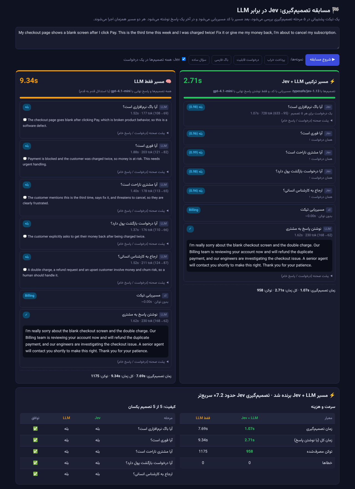
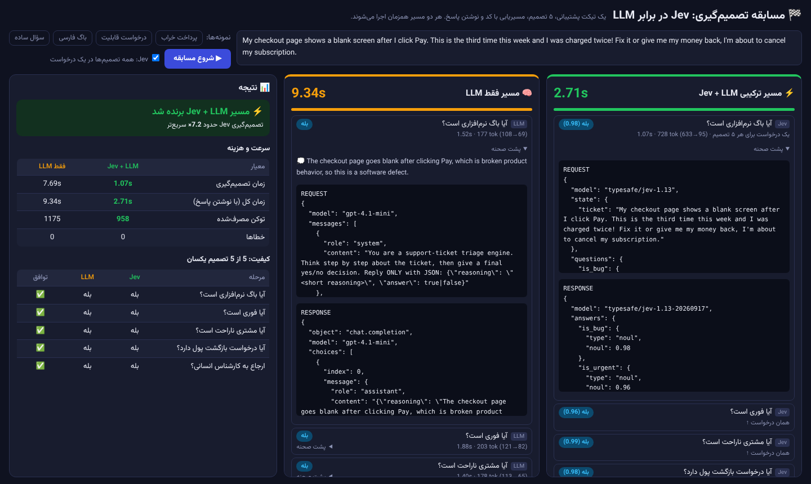

# مسابقه Jev در برابر LLM

یک دموی آموزشی ساده که نشان می‌دهد وقتی تصمیم‌گیری‌ها به **Jev** سپرده شود و LLM فقط برای تولید متن به کار برود، کار چقدر سریع‌تر و ارزان‌تر انجام می‌شود.

یک تیکت پشتیبانی همزمان از دو مسیر بررسی می‌شود و برای هر مرحله زمان، توکن مصرفی و «پشت صحنه» (درخواست و پاسخ خام API) نمایش داده می‌شود.


[دیدن فیلم با کیفیت کامل (MP4)](screenshots/demo.mp4)



## مراحل کار

| مرحله | مسیر ترکیبی (Jev + LLM) | مسیر فقط LLM |
|---|---|---|
| ۱ تا ۵: باگ است؟ فوری است؟ مشتری ناراحت است؟ پولش را می‌خواهد؟ به کارشناس انسانی برود؟ | Jev، هر ۵ سؤال در یک درخواست (یا جداگانه، با تیک) | LLM، هر سؤال یک درخواست با استدلال قدم‌به‌قدم |
| ۶: مسیریابی (Billing / Engineering / Customer Success) | کد ساده | کد ساده |
| ۷: نوشتن پاسخ به مشتری | LLM | LLM |

در پایان، جدول مقایسه‌ی زمان، توکن و میزان توافق تصمیم‌ها نمایش داده می‌شود.

## اجرا

۱. فایل `.env.example` را کپی کنید، اسمش را `config.env` بگذارید و کلیدهای API خودتان را در آن بنویسید:

```
JEV_API_KEY=...      # کلید Jev
LLM_API_KEY=...      # کلید سرویس LLM سازگار با OpenAI (مثلاً AvalAI)
LLM_MODEL=gpt-4.1-mini
```

۲. یکی از این دو روش را انتخاب کنید:

- **با Python 3** (هیچ پکیجی لازم نیست): در ویندوز روی `run.bat` دوبار کلیک کنید، یا در ترمینال بزنید `python server.py`.
- **بدون Python (ویندوز):** فایل `release/llmVsJev.exe` را کنار `config.env` بگذارید و اجرا کنید.

۳. آدرس http://localhost:8000 را باز کنید (exe خودش مرورگر را باز می‌کند) و دکمه‌ی «شروع مسابقه» را بزنید.

برای ساختن دوباره‌ی exe از سورس Go:

```
GOOS=windows GOARCH=amd64 go build -o llmVsJev.exe .
```

## یک اجرای واقعی

نتیجه‌ی یک بار اجرا روی تیکت «صفحه پرداخت سفید می‌شود و دو بار پول کم شده»:

| | Jev (۵ تصمیم در یک درخواست) | gpt-4.1-mini (۵ درخواست) |
|---|---|---|
| زمان تصمیم‌گیری | حدود ۱.۰ تا ۱.۹ ثانیه | حدود ۷.۷ ثانیه |
| توکن | ۷۲۸ | ۹۴۵ |
| توافق تصمیم‌ها | ۵ از ۵ | ۵ از ۵ |

اگر Jev هر سؤال را جداگانه بپرسد، سرعتش در هر درخواست تقریباً با gpt-4.1-mini برابر است. برتری اصلی Jev از این می‌آید که همه‌ی تصمیم‌ها را در یک درخواست می‌گیرد و برای هر تصمیم یک عدد اطمینان (مثلاً ۰.۹۷) برمی‌گرداند.

> اسکرین‌شات‌ها و فیلم با یک API شبیه‌سازی‌شده گرفته شده‌اند که زمان‌ها و توکن‌هایش از همین اجرای واقعی برداشته شده است.

## پشت صحنه



## فایل‌ها

- `server.py`: سرور Python (فقط کتابخانه‌ی استاندارد). مراحل در لیست `STEPS` تعریف شده‌اند.
- `index.html`: رابط کاربری.
- `main.go`: همان سرور به زبان Go برای ساختن exe.
- `fonts/`: فونت [Vazirmatn](https://github.com/rastikerdar/vazirmatn) (مجوز OFL).
